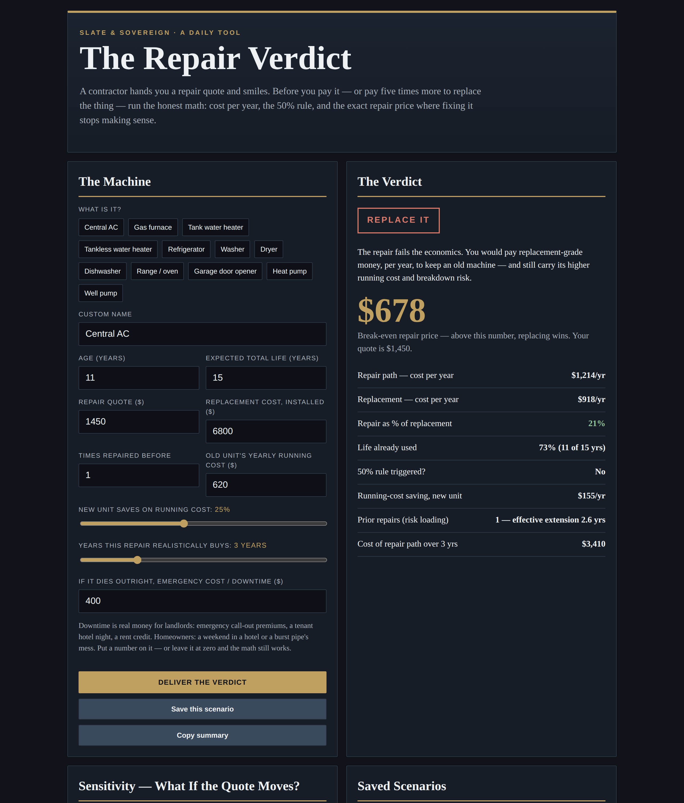
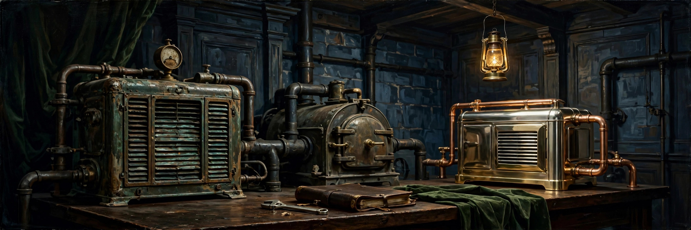

# The Repair Verdict

**Live:** https://thebullbrew.github.io/repair-verdict/

Repair or replace? This tool judges a contractor's repair quote the way an owner should: by cost per year, not sticker shock. Pick from a 12-item library (central AC, furnace, water heaters, heat pump, washer, fridge, and more) or enter your own machine, then add its age, expected life, the repair quote, the installed replacement cost, prior repairs, and what the old unit costs to run each year.

## What it does

- **Three verdicts** — REPAIR IT / REPLACE IT / FIX IT — ONCE, WITH A CAP — rendered as a seal, with the reasoning in plain English
- **Break-even repair price** — the exact quote above which replacing wins, so you know your walk-away number before the van is in the driveway
- **Cost-per-year comparison** — repair path (quote spread over the years it realistically buys, risk-loaded for prior repairs, plus the old unit's running cost) vs replacement (installed cost spread over a full new life, plus the new unit's lower running cost)
- **The 50% rule, checked honestly** — repair ≥50% of replacement *and* age ≥50% of life flags the classic trap, but age and running cost still get a vote
- **Emergency / downtime cost** — an optional number for landlord reality: call-out premiums, a tenant hotel night, a rent credit
- **Sensitivity table** — verdicts at 50% / 75% / 100% / 125% / 150% of the quoted repair price, because quotes move once the unit is opened up
- **Saveable scenarios + copy summary**, all in localStorage — no backend, no accounts, nothing leaves the device

## The method

A $1,450 repair that buys 3 years costs about $483 a year for the fix itself. A $6,800 replacement over a 15-year life costs about $453 a year — before its lower running cost. That comparison decides it. Prior repairs load the risk: each earlier fix shortens the extension you should trust. And old machines tax you quietly — the running-cost gap, multiplied by the years you'll keep paying it, belongs in the repair column, because choosing repair is choosing that tax.

## Design

Dark old-money variation 10 — Slate & Sovereign: slate-black `#10141A`, steel-gold `#C0A060`, slate-blue `#3A4A5C`, sharp 2px corners, precise grid lines, tabular numerals. A trading desk in a mahogany-paneled room.

## How to run

Open `docs/index.html` in any browser, or serve the `docs/` folder with any static host. It's a PWA — installable, with an offline fallback to the cached app shell.
